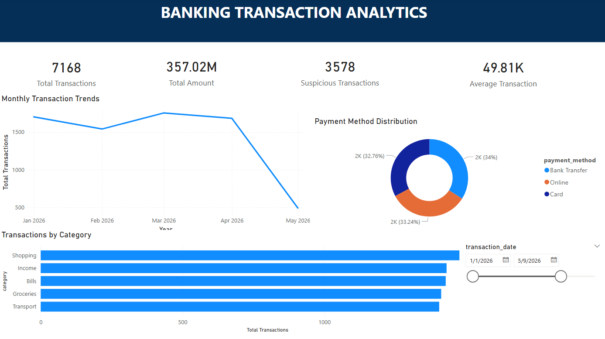

# Banking Transaction ETL Pipeline

End-to-end portfolio ETL pipeline: **CSV → Pandas validation/transform → CSV + MySQL → Power BI**.

> **Data honesty:** The original uploaded source CSV contains **10 records**. This repository includes a *separate optional generator* for 10,000+ **synthetic** records to benchmark the workflow. The 10,000-row dataset is **not real banking data**. The existing `.pbix` is preserved unchanged; its visuals have not been regenerated or verified against the synthetic sample.

## Features
- Required-column validation, date/numeric coercion, null/invalid row rejection and transaction ID deduplication
- Missing optional fields set to `Unknown`; configurable amount-based `is_suspicious` **rule flag, not fraud prediction**
- CSV-only mode for running without MySQL
- MySQL snapshot refresh inside a transaction, avoiding duplicate records on rerun (rather than `to_sql(if_exists="replace")` on every run)
- Clear failure exit code, logging, unit tests, and 10k synthetic record generator

## Power BI Dashboard Preview



### Dashboard Features
- 10,000 synthetic banking transactions
- Total Transactions: 10,000
- Total Amount: 497.42M
- Average Transaction: 49.74K
- Suspicious-Flagged Transactions: 4,963
- Monthly Transaction Trends
- Payment Method Distribution
- Transaction Category Analysis
- Interactive Date Range Filter

## Project layout
```text
Banking-Transaction-ETL-Enhanced/
  data/raw_transactions.csv         # Provided 10-row sample
  dashboard/banking_dashboard.pbix   # Original Power BI dashboard (unchanged)
  scripts/{main,extract,transform,load,generate_sample}.py
  sql/create_database.sql
  tests/test_pipeline.py
  .env.example
  requirements.txt
```

## Windows setup (PowerShell)
```powershell
py -m venv .venv
.venv\Scripts\Activate.ps1
python -m pip install -r requirements.txt
python -m unittest discover -s tests -v
python -m scripts.main --skip-db
```

## MySQL execution
1. Start MySQL, then run `sql/create_database.sql` once with your MySQL client.
2. Copy `.env.example` to `.env`; set `DB_USER`, `DB_PASSWORD`, `DB_HOST`, `DB_NAME`.
3. From repository root, run `python -m scripts.main`.
4. The `transactions` table is created on first load and **refreshed** on subsequent runs. Snapshot mode assumes this pipeline owns the table; do not use for shared production tables.

## Generate a synthetic 10,000-row dataset
```powershell
python -m scripts.generate_sample --rows 10000
python -m scripts.main --input data/synthetic_transactions.csv --skip-db
# After configuring MySQL, omit --skip-db to load the synthetic dataset
```

## Power BI
Open `dashboard/banking_dashboard.pbix` in Power BI Desktop. The original report may reference a database/table already on the creator's machine: update the data source to your **local** MySQL configuration and refresh. Verify that visual totals agree with the selected dataset. Example KPIs to add/check: total rows, total amount, failed count, high-value flagged count, payment-method distribution, transaction volume by date. **Do not claim any percentage change or detected trend until verified against the data.**

## Limitations and safety
- The suspicious flag is a fixed amount threshold, and can flag legitimate salary transfers. It is not machine-learning fraud detection.
- Generated data is fictional and is for demonstration/testing only.
- No passwords, `.env`, or real customer data should be committed to GitHub.
- This is an educational portfolio project, not a production-grade banking compliance or fraud-control system.
